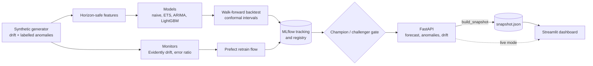

# FlowRadar

[](https://github.com/RahimAbbas55/FlowRadar/actions/workflows/tests.yml)


Cash flow forecasting and anomaly detection with a full MLOps lifecycle. FlowRadar forecasts daily net cash flow per account segment 30 days ahead with calibrated prediction intervals, flags days that fall outside them, and manages the model lifecycle: tracking, a registry with a champion/challenger gate, drift and error monitoring, and a retrain flow.

> **Read this first.** All data is **synthetic**, generated with injected drift and labelled anomalies, because real transaction data is private and injected drift is the only way to prove the monitoring works. No claim is made about real-world accuracy. The public demo is a **static demo**: it serves results the real pipeline computed once and stored in a file, with no live model behind it.

## Live demo

**LIVE_DEMO_URL**

Pick a segment, a forecast interval (80, 90 or 95%), an anomaly sensitivity (strict, balanced or sensitive) and a review window (7 to 90 days). Every choice shows a stored result from the real pipeline. The drift tab shows the monitor status computed when the snapshot was built.

| 30-day forecast | Recent days and flagged anomalies | Drift and model |
|---|---|---|
|  |  |  |

## What it does

- **Synthetic data generator.** Three segments (salaried, freelancer, small business) with UK payday cycles, bank holidays, tax and VAT dates. Injects abrupt, gradual and volatility drift, and six anomaly types with ground-truth cause labels. Fully seeded.
- **Forecasting.** Seasonal-naive, ETS, ARIMA and LightGBM, evaluated by strict walk-forward backtesting with split conformal prediction intervals calibrated per segment.
- **Anomaly detection.** A day is flagged when the actual value falls outside a strict conformal interval calibrated only on out-of-sample days before it. Scored against the injected labels.
- **MLOps.** MLflow tracking and registry, a champion/challenger promotion gate, Evidently data drift, a forecast-error monitor, and a Prefect flow that decides whether to retrain and promotes a better model.
- **Serving.** A FastAPI service (`/forecast`, `/anomalies`, `/drift`, `/health`) and a Streamlit dashboard.

## Architecture



The deployed demo reads `snapshot/snapshot.json`, which is built by running the real API app against every choice the dashboard offers. The stored responses are checked against the live API by a test.

## Results

All numbers are from the synthetic data and a single dataset seed unless stated. Nominal interval coverage is 90%.

### Forecasting (observed series, 30-day horizon, 6 walk-forward folds)

| Model | MASE (mean ± std over folds) | Interval coverage | Worst-segment coverage | Interval width (MASE units) |
|---|---|---|---|---|
| ETS | 0.89 ± 0.11 | 0.896 | 0.822 | 4.12 |
| LightGBM | 1.01 ± 0.11 | 0.879 | 0.770 | 4.86 |
| Seasonal naive | 1.59 ± 0.29 | 0.918 | 0.872 | 12.17 |

- **ETS had the lowest error on this seed, and the statistical baseline was not beaten.** LightGBM is competitive but its intervals are wider and under-cover, which means its errors drift over time and calibration on the preceding 30 days does not carry over. Both beat seasonal-naive by about 30 to 40% in error and a factor of 2.5 to 3 in interval width.
- AutoARIMA was run in a 2-fold comparison only (observed MASE 0.98, coverage 0.93) and is left out of the table for that reason.
- "Worst-segment coverage" is the mean over folds of the worst segment's coverage in each fold. It is biased low by construction, so 0.82 to 0.88 is consistent with correct calibration.
- **LightGBM is the served model, even though ETS scored better.** It is the only model here that produces a persistable artifact for the registry and gate. ETS refits from scratch on each call. LightGBM also receives payday, tax and VAT flags that the other models do not, so the comparison is not like for like.
- sMAPE is not reported: net values sit near zero, which makes it unusable here. MASE is also not comparable between the observed and counterfactual series, because anomaly spikes inflate the naive-error scale.

### Anomaly detection (10 seeds, drift off, 525 judged days per seed)

| Sensitivity (alpha) | Precision | Recall | False-positive rate on clean days |
|---|---|---|---|
| 10% | 0.15 | 0.50 | 8.5% |
| 5% | 0.28 | 0.45 | 3.4% |
| 1% | 0.61 | 0.14 | 0.3% |

- **The intervals are valid.** The false-positive rate on clean days is at or below the nominal level at every sensitivity.
- **The detector has limited power.** Recall at 5% is 0.45 (0.53 counting only days that changed the series). Only about 3% of judged days are anomalous, which caps precision.
- **Detection depends on the anomaly's size relative to the interval:**

| Anomaly size ÷ interval half-width | Anomalous days | Flagged |
|---|---|---|
| under 1 | 134 | 8 (6%) |
| 1 to 2 | 122 | 82 (67%) |
| 2 or more | 129 | 114 (88%) |

About a third of anomalous days are smaller than the interval is wide and are essentially undetectable at the daily-net level.

- **Per-type event recall** (an event counts if any of its days was flagged, 95% Wilson interval):

| Anomaly type | Events detected | Recall (95% interval) |
|---|---|---|
| Payroll delay | 44 of 44 | 100% (92 to 100%) |
| Client payment delay | 23 of 42 | 55% (40 to 69%) |
| Duplicate or suspicious debit | 15 of 29 | 52% (34 to 69%) |
| Business closure | 21 of 41 | 51% (37 to 66%) |
| Large unplanned payment | 17 of 45 | 38% (25 to 52%) |

Payroll delay is the easiest because it is large, lands on a predictable income pattern, and creates two anomalous days.

### Drift and the retrain loop (simulated)

The drift demo (`python -m flowradar.demo.drift_demo`) halves one segment's inflow part-way through the data. At the checkpoint before the shift nothing retrains. At the checkpoint after it, the drift monitor flags that segment and only that segment, a challenger is trained and scored on the same holdout as the champion, and the gate promotes it. The forecast-error monitor did not fire in this scenario because the champion adapts through its lag features, which is why both monitors exist. A level shift is the easy case, and gradual and volatility drift are not demonstrated.

## What went wrong along the way

- **A "30-day" backtest that was not one.** The LightGBM and seasonal-naive wrappers built lag features on train and test together, so every test day used actual values from the day before. Two of four models were being scored on one-day-ahead forecasts. It surfaced while designing the forecast service. The fix is horizon-safe features (every lag at least the horizon) and tests that scramble the test-window actuals and assert no model's predictions change.
- **Intervals calibrated at the wrong horizon.** Calibration residuals were 1 to 30 days ahead but the test forecasts were 31 to 60 days ahead. The harness now forecasts from the full training set so both match.
- **Anomalies that changed nothing.** Injected anomalies scaled the day's existing value, so on days with no payment they did nothing, and delays chained onto money an earlier delay had moved. A counterfactual-diff test over five seeds caught it. About 7 of 41 labelled events were invisible by construction.
- **A circular detector.** Judging days against an interval calibrated on those same days lets the largest residual set the width, so nothing can exceed it. Anomaly flags are calibrated only on days before the window being judged.
- **One pooled conformal quantile.** A single quantile across segments is set by the largest segment and under-covers it. Calibration is per segment, and the harness reports worst-segment coverage because pooled coverage hid it.
- **A hypothesis I got wrong.** I expected injected anomalies to cause false alarms 30 to 57 days later through the lag features. The measured false-positive rate was 3.5% on exposed days and 3.4% on unexposed days, so there was no echo effect.

## Stack

| Layer | Technology |
|---|---|
| Language | Python 3.12 |
| Data | pandas, numpy, pydantic |
| Forecasting | LightGBM, statsforecast (ETS, ARIMA), split conformal prediction |
| MLOps | MLflow (tracking, registry aliases), Evidently (drift), Prefect 3 (retrain flow) |
| Serving | FastAPI |
| Dashboard | Streamlit, Altair |
| Testing and CI | pytest, GitHub Actions |
| Deployment | Streamlit Community Cloud (static snapshot), optional Docker Compose |

## Quick start

```bash
pip install -r requirements.txt
pip install -e .
streamlit run deploy/streamlit_app.py     # the dashboard, from the committed snapshot
pytest -q                                  # the test suite
```

Reproduce the results:

```bash
python -m flowradar.tracking.dataset_comparison --folds 6 --models lightgbm ets seasonal_naive --data observed
python -m flowradar.evaluation.multi_seed          # 10-seed detector evaluation
python -m flowradar.demo.drift_demo                # simulated drift and retrain loop
python -m flowradar.dashboard.build_snapshot       # rebuild snapshot/snapshot.json (add --regenerate for new data)
```

Run the live API and dashboard together:

```bash
MLFLOW_TRACKING_URI=sqlite:///api.db uvicorn flowradar.serving.api:build_app --factory --port 8000
FLOWRADAR_API_URL=http://localhost:8000 streamlit run src/flowradar/dashboard/app.py
```

Docker Compose runs the same two services locally (`docker compose up`, builds for `linux/amd64` by default, override with `FLOWRADAR_PLATFORM`; host ports with `FLOWRADAR_API_PORT` and `FLOWRADAR_DASHBOARD_PORT`). The images are not part of the live demo and are not built in CI.

Deploying the dashboard to Streamlit Community Cloud is described in [deploy/README.md](deploy/README.md).

## Project layout

```text
src/flowradar/
  segments/ drift/ anomalies/   synthetic generator and ground-truth labels
  features/ models/             horizon-safe features, the four forecasters
  evaluation/                   walk-forward backtest, conformal intervals, detector evaluation
  tracking/                     MLflow tracking, registry, champion/challenger gate
  monitoring/ flows/            drift and error monitors, Prefect retrain flows
  serving/                      forecast service and FastAPI app
  dashboard/                    API and snapshot clients, charts, Streamlit app, snapshot builder
  demo/                         simulated drift scenario
deploy/                         Streamlit Community Cloud entrypoint and requirements
snapshot/                       the precomputed results the deployed app reads
docker/                         optional Dockerfiles
tests/                          pytest suite
```

## Testing

The suite covers the generator, features, models, evaluation, tracking, monitors, flows, API and dashboard. Leakage tests check that features and every model's predictions are unchanged when the forecast window's actuals are scrambled. Deployment tests check the committed snapshot, the deploy requirements against what the app imports, and this README's links. CI runs the whole suite on every push to `main` and every pull request.

## Known limitations

- **Everything is synthetic.** The generator's structure (weekly seasonality, paydays) is close to what the models assume, so absolute accuracy says little about real data.
- **The event features hand LightGBM the generator's calendar rules** (payday, VAT and tax dates). On real data the gain would be smaller.
- **One dataset seed for the model comparison**, so no ranking beyond "the statistical baseline was not beaten" is claimed.
- **The detector has limited power**, and anomalies smaller than the interval cannot be detected at the daily-net level. Freelancer anomalies are small against that segment's invoice noise.
- **The forecast-error monitor is insensitive to shifts that stay inside the model's training range.** The drift monitor covers that gap.
- **Anomalies sit inside training windows**, which is realistic but costs accuracy.
- **The live demo is static.** There is no live model, API or retrain loop behind it. The controls choose between stored results.
- **A `relative` interval mode exists and is tested, but is not the default and was not evaluated.**
- VAT dates are simplified to fixed days of the month. Dependencies are not pinned except Streamlit in the deploy requirements. The API has no authentication. No neural forecaster (N-BEATS) was built.

## Status

| Phase | Scope | Status |
|---|---|---|
| 1. Data | Generator, drift and anomaly injection, labels | Done |
| 2. Forecasting | Baselines, ETS, ARIMA, LightGBM, walk-forward backtest, conformal intervals | Done |
| 3. Anomaly detection | Detector evaluated against injected labels | Done, with modest results |
| 4. MLOps | Tracking, registry, gate, drift and error monitors, retrain flow, simulated demo | Done |
| 5. Serving and UI | FastAPI, Streamlit, Docker Compose | Done |
| 6. Ship | CI, Streamlit Community Cloud deployment, README | Done |
| 7. Explainer | LoRA SFT and DPO model that writes analyst notes for flagged days | Planned as a separate project that consumes the `/anomalies` API |

## License

MIT, see [LICENSE](LICENSE).